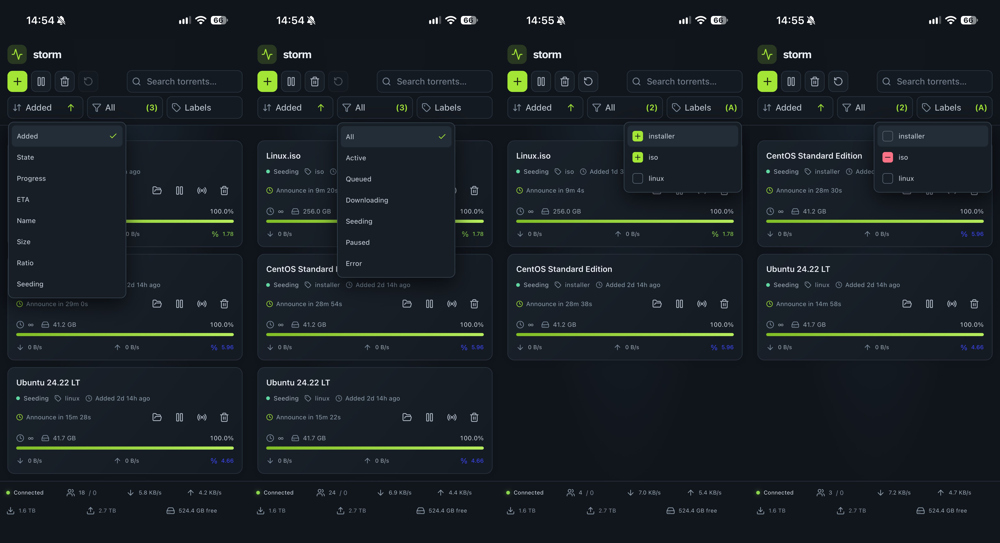

# Storm

<p align="center"></p>

Storm is a responsive web interface for managing a Deluge client remotely. Its React frontend talks to a Go HTTP API, which connects to Deluge over RPC. The frontend bundle is embedded in the Go binary, so production can run as a single application container.

The interface supports viewing, adding, pausing, resuming, deleting, filtering, and labeling torrents, along with viewing session and disk information.

<p align="center">
  
  
</p>

## Run with Docker

Storm must be able to reach Deluge's RPC daemon. Put both containers on a Docker network and enable remote RPC in Deluge's `core.conf`:

```json
"allow_remote": true
```

Set these environment variables in your shell or secret manager before starting Storm. In production, `STORM_API_KEY` is required and may contain up to 32 characters. Use a unique random key; for a 32-character hexadecimal key, generate one with `openssl rand -hex 16`. The Deluge username and password must match an account in Deluge's `auth` file.

```sh
export STORM_API_KEY="$(openssl rand -hex 16)"
export DELUGE_RPC_HOSTNAME=deluge
export DELUGE_RPC_USERNAME=localclient
export DELUGE_RPC_PASSWORD='your-deluge-rpc-password'
```

Run the published image on the same Docker network as Deluge:

```sh
docker run --name storm \
  -p 127.0.0.1:8221:8221 \
  -e DELUGE_RPC_HOSTNAME=deluge \
  -e DELUGE_RPC_USERNAME=username \
  -e DELUGE_RPC_PASSWORD=password \
  -e STORM_API_KEY=apikey \
  ghcr.io/malwinmp/storm
```

The loopback binding is intended for a reverse proxy on the Docker host.

The Compose example in `docker-compose/` runs Storm only; Deluge must already be running and reachable from storm container. Set `DELUGE_RPC_HOSTNAME`, `DELUGE_RPC_USERNAME`, `DELUGE_RPC_PASSWORD`, and `STORM_API_KEY` in `docker-compose/.env`, then run `docker compose up -d` from that directory. The Compose example binds Storm to loopback for use behind a reverse proxy.

## Public access and security

The static frontend is public. In production, the API requires `STORM_API_KEY`; startup fails if the key is missing or longer than 32 characters. The UI prompts for the key when it first calls the API. After authentication, the server uses an `HttpOnly`, `Secure`, `SameSite=Strict` cookie. The key is not persisted by the frontend in browser storage.

For internet access, terminate TLS at an HTTPS reverse proxy and forward the public hostname to Storm's loopback listener at `http://127.0.0.1:8221`. Do not publish Storm's HTTP port directly to the internet. Use a unique random API key and protect both it and the Deluge RPC credentials.

`--dev-mode` (or `DEV_MODE`) disables API authentication entirely and serves the built frontend from disk, even if an API key is configured. Use it only for local development.

## Configuration

Options can be supplied as command-line flags or environment variables.

| Environment variable | Purpose | Default |
| --- | --- | --- |
| `STORM_API_KEY` | API authentication key; maximum 32 characters | Required in production, unused in development mode |
| `STORM_BASE_PATH` | URL path prefix at which Storm is served | `/` |
| `DELUGE_RPC_VERSION` | Deluge RPC protocol version: `v1` or `v2` | `v1` |
| `DELUGE_RPC_HOSTNAME` | Deluge RPC host; required | — |
| `DELUGE_RPC_PORT` | Deluge RPC port | `58846` |
| `DELUGE_RPC_USERNAME` | Deluge RPC username | Empty |
| `DELUGE_RPC_PASSWORD` | Deluge RPC password | Empty |

The command-line flags use the corresponding names, for example `--api-key`, `--base-path`, `--listen`, `--hostname`, and `--deluge-version`. Run `storm --help` for the complete list.

## Deluge Version

Deluge has a different interface between versions 1 and 2. You must set `DELUGE_RPC_VERSION` to either `v1` or `v2` based on the version you have installed. Storm defaults to `v1`.

Note that in version 2, different RPC users are not able to see torrents created by another user [(#38)](https://github.com/relvacode/storm/issues/38). If you're using multiple Deluge clients (such as the vanilla Web UI, or Sonarr, etc) you should make sure they're all using the same Deluge RPC account to connect to Deluge.

## Development

The frontend uses React, Vite, Tailwind CSS 4, and lucide-react. The backend uses Go 1.27.3. The Docker build uses Node.js 22 and Go 1.27.3.

Install the frontend dependencies and build the bundle first. The build output is embedded into the Go application and is also needed by `go:embed` when compiling locally.

```sh
cd frontend
npm ci
npm run build
```

In a separate terminal, run the backend in development mode. Set the Deluge RPC connection variables for your environment; `DELUGE_RPC_HOSTNAME` is required.

```sh
go run ./cmd/storm --listen=127.0.0.1:8221 --dev-mode [OPTIONS...]
```

To run the Vite development server, open another terminal and run:

```sh
cd frontend
npm run start
```

Vite listens on `0.0.0.0:5173` and proxies `/api` requests to the backend at `127.0.0.1:8221`.
